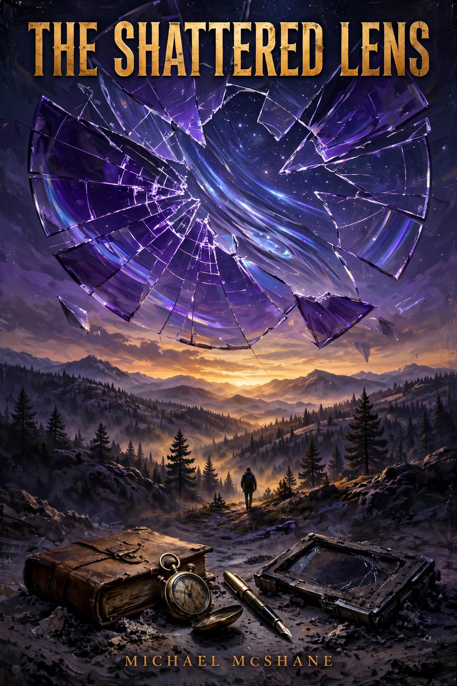

# The Shattered Lens

A hard-dystopian post-apocalyptic narrative detailing the collapse of structural infrastructure following the Astraea-9 impact event and the subsequent regression of human trust architecture from silicon logic back to scribal ledger systems.

## Dedication

[For Jen](dedication.md).

## Technical Lore & Theoretical Framework

### 1. The Ephemeris Divergence (Astraea-9)
Astraea-9 was an uncatalogued, eleven-kilometer long-period carbonaceous chondrite carrying a highly volatile core of methane ice and interstratified nickel-iron matrix. Emerging from a chaotic Oort cloud perturbation, its initial signature was masked by solar glare and misclassified by automated orbital determination pipelines running on truncated baseline observations. The institutional failure to predict the impact was not purely mathematical; it was systemic, caused by the failure of public data validation layers.

### 2. The Cryptographic Decoupling
Coincident with the orbital crisis, the global public key infrastructure (PKI) experienced an irrecoverable logic loop within the primary key-distribution networks in Utah. Due to a forced structural deprecation of legacy security certificates and the fragmentation of regional Network Time Protocols (NTP), modern operating systems began treating valid authentication tokens as hostile. Without centralized certificate authorities (CAs) or live two-factor authentication (2FA) handshake loops, access to modern silicon architectures locked from the inside out before physical kinetic disruption occurred.

### 3. The Kinetic and Ionization Inversion
Upon impact with the Pacific shelf near Point Conception (34.4481° N, 120.4714° W), Astraea-9 drove massive kinetic overpressure through the San Andreas fault system while generating an atmospheric ionization event. High-altitude particulate dispersion of superheated sea salt and pulverized granite created a dense, conductive aerosol layer across the stratosphere. This inversion permanently degraded radio frequency propagation and initiated systemic failure in solid-state devices lacking legacy high-vacuum or mechanical isolation.

## Repository Architecture

The manuscript is constructed modularly to support a target volume of 480,000 words across 12 chapters. Each chapter is broken into five distinct, high-fidelity narrative modules.

## Cover and License

Cover art (`cover.webp`) AI-generated with Muse (October 2026), released under CC BY 4.0 alongside the text.
